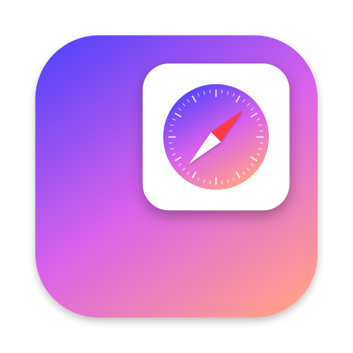
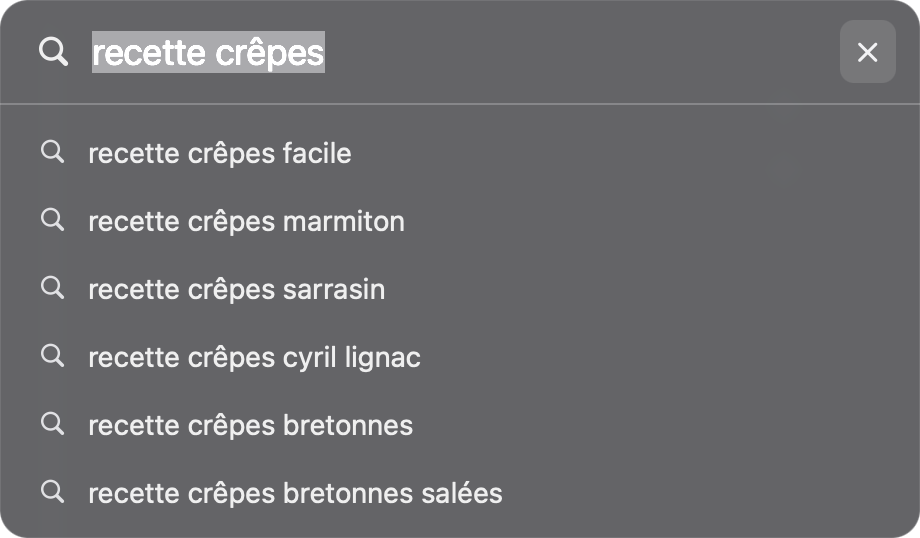
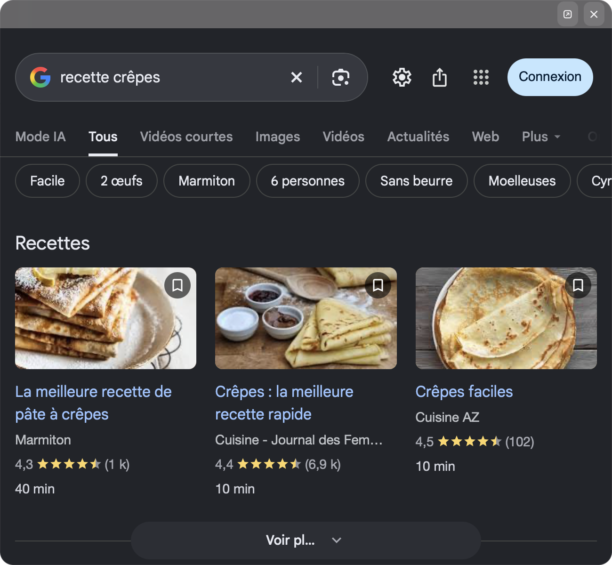

<p align="center">
  
</p>

<h1 align="center">Little Browser</h1>

<p align="center">
  <b>Arc's “Little Arc”, rebuilt as a tiny native macOS app.</b><br>
  Hit <kbd>⌘</kbd><kbd>⌥</kbd><kbd>N</kbd> anywhere, search, glance, close. No tabs, no clutter.
</p>

<p align="center">
  
  
  
  
</p>

---

When I left [Arc](https://arc.net), the one thing I really missed was **Little Arc**: a small throwaway window for a quick lookup that never pollutes your real tabs. Browser extensions can't draw a frameless floating window, so Little Browser is a ~600-line native app instead.

<p align="center">
  
  &nbsp;&nbsp;
  
</p>

## How it works

1. Press <kbd>⌘</kbd><kbd>⌥</kbd><kbd>N</kbd> from any app. A single search bar drops into the **top-right corner** of your screen.
2. Type: Google suggestions appear as you go. Pick one with <kbd>↑</kbd> <kbd>↓</kbd>.
3. Press <kbd>↵</kbd>: the bar smoothly grows into a 650 × 600 window showing the page.
4. Done? <kbd>Esc</kbd> and it's gone. Want to keep it? <kbd>⌘</kbd><kbd>↵</kbd> sends it to your main browser.

URLs work too: `github.com`, `localhost:3000`, `https://…` open directly instead of searching.

## Shortcuts

| Shortcut | Action |
| --- | --- |
| <kbd>⌘</kbd><kbd>⌥</kbd><kbd>N</kbd> | Open / close Little Browser (global) |
| <kbd>↵</kbd> | Search or open the URL |
| <kbd>⌘</kbd><kbd>↵</kbd> | Open in your default browser |
| <kbd>↑</kbd> <kbd>↓</kbd> | Browse suggestions |
| <kbd>Esc</kbd> · <kbd>⌘</kbd><kbd>W</kbd> | Close |
| <kbd>⌘</kbd><kbd>L</kbd> | Bring the search bar back to type a new address |
| <kbd>⌘</kbd><kbd>R</kbd> | Reload |
| <kbd>⌘</kbd><kbd>[</kbd> · <kbd>⌘</kbd><kbd>]</kbd> | Back · Forward (or swipe) |

## Features

- **Global hotkey** that works even when your browser is closed.
- **Frameless, floating, rounded** window with native blur. No title bar, no URL bar, no tabs.
- **Live Google suggestions**, keyboard-driven.
- **Pre-warmed web engine**: the connection to Google is opened while you type, so results show up fast.
- **Smooth animations** and no white flash in dark mode.
- **Lives in the menu bar** (compass icon), never in the Dock.
- Works with **AZERTY and QWERTY** keyboards.
- **One Swift file, zero dependencies.** Read it in ten minutes.

## Install

You need macOS 13+ and Xcode or the Command Line Tools (`xcode-select --install`).

```bash
git clone https://github.com/wepee/little-browser.git
cd little-browser
./build.sh install
```

This builds the app, copies it to `/Applications` and launches it. Press <kbd>⌘</kbd><kbd>⌥</kbd><kbd>N</kbd>.

**Launch at login:** System Settings → General → Login Items → **+** → *Little Browser*.

> The app is ad-hoc signed on your machine, so Gatekeeper won't complain when you build it yourself.

## Customize

Everything lives at the top of [`Sources/main.swift`](Sources/main.swift):

| What | Where |
| --- | --- |
| Window sizes, margin | `BAR_W`, `FULL_W`, `FULL_H`, `MARGIN` |
| Browser for <kbd>⌘</kbd><kbd>↵</kbd> | `BROWSER_ID`: `nil` (default browser) or a bundle id, e.g. `com.google.Chrome`, `com.apple.Safari` |
| Search engine | `toURL()` and `fetchSuggestions()` |
| Hotkey | `registerHotKey()` (`kVK_ANSI_N`, `cmdKey \| optionKey`) |

Then run `./build.sh install` again.

The icon is drawn in code: tweak [`scripts/make-icon.swift`](scripts/make-icon.swift) and run `./scripts/make-icon.sh`.

## Limitations

- Pages are rendered by **WebKit** (Safari's engine), not by your main browser. You'll need to sign in to sites once, and your browser extensions (password manager…) aren't available inside.
- The window always opens on the **main display**.
- Links that try to open a new tab load in the same window.

## Project layout

```
Sources/main.swift        the whole app
Resources/Info.plist      bundle metadata (menu-bar app, no Dock icon)
Resources/AppIcon.icns    generated icon
scripts/make-icon.*       icon generator
build.sh                  build, sign and optionally install
```

## License

[MIT](LICENSE)
